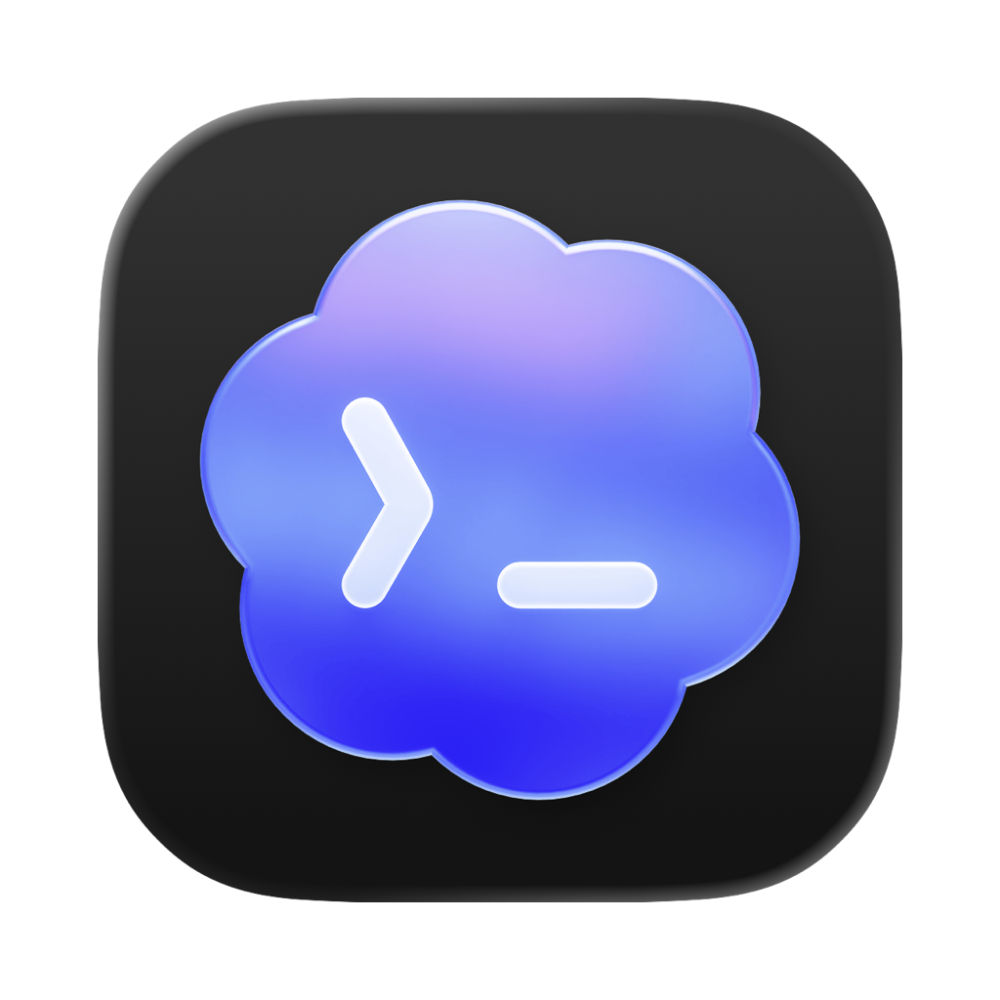

<div align="center">
  
  <h1>Codex Usage Menu</h1>
  <p>在 macOS 菜单栏中查看 Codex 与 agy CLI 的剩余额度，支持自动跟随 agy 模型。</p>

  [](https://github.com/cjkcr/CodexUsageMenu/releases/latest)
  [](https://github.com/cjkcr/CodexUsageMenu/releases/latest)
  [](https://github.com/cjkcr/CodexUsageMenu/releases/latest)
</div>

<p align="center">
  <picture>
    <source media="(prefers-color-scheme: dark)" srcset="docs/menu-bar-dark.png">
    
  </picture>
</p>

Codex Usage Menu 是一款轻量的原生 macOS 菜单栏工具。它通过本机已登录的 CLI 读取剩余额度，可选择显示 Codex 或 Gemini（agy CLI）用量。

## v1.1.1 更新

- **支持 Gemini 4 Hydrogen**：可手动选择，也能自动跟随 Low / Medium / High / XHigh，显示对应的 `5 H` 与 `WEEK` 额度，并明确标注共享池。
- **全新用量窗口**：统一原生控件、字体和留白，额度卡片增加细进度条与重置时间，窗口根据当前来源调整高度。
- **重新设计下拉菜单**：集中呈现剩余比例、重置时间和更新时间；各额度池分组显示，长模型名不再撑宽主菜单。
- **更易区分的图标**：Gemini 改为较小的中空描边图标，保持透明背景，并随系统适配前景颜色。
- **浅色与深色适配**：柔和的分组背景、边框和清晰文字，在两种外观中保持一致层次。

### v1.1.0 引入的功能

- **新增 agy CLI 支持**：在 Codex / Gemini 用量之间切换，并记住选择。
- **按模型查看额度**：支持 agy 返回的 Gemini、Argon、Claude 和 GPT 等模型额度池，可手动选择模型。
- **自动跟随 agy 模型**：默认跟随 agy 保存的模型选择，变化后立即切换已缓存的对应额度，无需等待下一次用量查询。
- **区分共享与独立额度**：共享池会明确标注；菜单中可查看各额度池的剩余比例和重置时间。
- **周额度显示更完整**：仅有周额度的模型，两栏显示相同的周剩余比例；第一栏以 `5 H*` 标明同步显示周额度。

自动跟随读取 agy 保存的模型设置。通过 `--model` 或 `--settings` 为单个终端会话临时指定模型时，请使用手动选择。详见下方 [agy 用量说明](#geminiagy-cli用量)。

## 下载与安装

前往 [GitHub Releases](https://github.com/cjkcr/CodexUsageMenu/releases/latest) 下载最新版本：

- **DMG**：打开后双击“安装 Codex Usage Menu.pkg”。
- **PKG**：直接运行 macOS 安装器。

应用固定安装到 `/Applications/Codex Usage Menu.app`，安装结束后会自动打开。它是纯菜单栏应用，因此不会占用 Dock，也不会出现在应用切换器中。

### 系统要求

- macOS 13 Ventura 或更新版本
- Apple Silicon 或 Intel Mac
- Codex：已安装并登录 Codex CLI，或已安装包含 Codex CLI 的 ChatGPT/Codex 应用
- Gemini：已安装并登录 agy CLI

### 首次打开

当前公开安装包使用本地签名，尚未经过 Apple Developer ID 签名与公证。如果 macOS 阻止首次打开，请进入“系统设置 → 隐私与安全性”，在安全性提示处选择“仍要打开”。请只从本项目的 Releases 页面下载安装包。

## 功能

- 菜单栏同时显示 5 小时和每周剩余用量。
- 可在“用量来源”菜单或用量窗口中切换 Codex / Gemini，并记住选择。
- Gemini 显示 agy 返回的 `5 H` / `WEEK` 剩余额度；其他独立额度池可从“agy 各额度池”查看。
- Gemini 默认“自动跟随 agy”：读取本机 agy 保存的模型设置，模型变化时自动切换菜单栏和用量窗口的额度；也可在“模型/额度”手动固定模型。
- Codex 显示服务端返回的可用重置次数；agy 未提供该数据，因此隐藏此项。
- 点击菜单栏可查看精确重置时间和最近更新时间。
- 支持完整、紧凑和仅图标三种显示方式。
- 自动适配刘海屏以及菜单栏空间较窄的 Mac。
- 自动适配浅色、深色和不同壁纸背景。
- 支持简体中文、繁体中文和英文界面。
- 单实例运行，重复打开不会产生多个菜单栏图标或进程。
- 关闭用量窗口后继续在菜单栏运行；再次从“应用程序”打开即可恢复窗口。

## 菜单栏显示方式

| 模式 | 行为 |
| --- | --- |
| 自动 | 刘海屏使用仅图标；窄屏使用紧凑模式；空间充足时显示完整内容 |
| 完整 | 显示 `5 H`、`WEEK`、百分比和来源图标；Codex 另显示重置次数 |
| 紧凑 | 缩短间距，在较少空间内保留主要信息 |
| 仅图标 | 只显示 24 点宽的应用图标，适合 13 英寸刘海屏 |

如果菜单栏项目过多，macOS 仍可能把项目藏在刘海后。可先关闭其他菜单栏项目，图标出现后按住 Command 将它拖到右侧。

## 刷新策略

应用启动或切换来源时立即查询所选来源，随后每 15 秒判断本机是否正在使用它：

- Codex 或 ChatGPT 位于前台，或最近 5 分钟内有 Codex 会话更新时，每 30 秒查询一次。
- agy 最近 5 分钟内有交互输入历史更新时，每 30 秒查询一次；监控器自身的 `/usage` 查询不计为使用活动。
- 未检测到使用活动时，每 10 分钟查询一次。
- “立即刷新”始终可以手动触发查询。

这种策略兼顾数据及时性与后台资源消耗。

## Gemini（agy CLI）用量

先安装 Antigravity CLI（`agy`）并登录，确认终端中的 `/usage` 正常，再在本应用选择“用量来源 → Gemini”。这里的 Gemini 入口包含 agy 返回的各模型额度池，不包含 Gemini 网页聊天或旧 Gemini CLI 额度。

- 调用 `agy --print /usage --output-format json --log-file /dev/null`，由 agy 自己处理登录和网络请求，本应用不读取 Google 登录凭据。
- 此次查询关闭 agy 自动更新，不提交模型生成请求。
- 自动查找 `~/.local/bin/agy`、Homebrew 及 `PATH`；未找到时可以手动选择。
- `5 H` / `WEEK` 显示当前所选模型对应额度池的剩余额度，向下取整；重置时间直接使用 agy 返回值。
- Argon、Claude/GPT 等独立池不会混入 Gemini 共享池，可在“agy 各额度池”查看。
- “模型/额度”按 agy 返回的模型说明生成选项，例如 Gemini Flash、Gemini Pro、Claude Opus、Claude Sonnet、GPT-OSS 和 Gemini 4 Argon；可用项目随账号及服务端变化。
- 支持 **Gemini 4 Hydrogen**，包括 Low / Medium / High / XHigh 的自动跟随。旧版 agy 的 `/usage` 说明可能仍只写 Flash / Pro，此时 Hydrogen 显示 Gemini 共享池的 `5 H` / `WEEK` 额度，并标注“共享额度”；若以后明确返回 Hydrogen 独立池，则优先使用该池。额度归属依据 [Antigravity 官方额度说明](https://antigravity.google/docs/plans)。
- “自动跟随 agy”监听 `~/.gemini/antigravity-cli/settings.json` 的模型变化，立即切换已缓存的额度，不额外发送生成请求。支持带版本号、推理强度的模型名匹配；无法唯一匹配时显示不可用。该文件是 agy 保存的模型选择，多个会话各自通过 `--model` / `--settings` 临时覆盖时，不能保证代表当前终端会话，可改为手动选择。
- 多个模型共享同一额度池时，选择它们会显示同一组真实额度，窗口会标明“共享额度”。仅有每周额度的模型，两栏均显示周额度；第一栏标为 `5 H*`，并说明它同步显示周额度，而非独立的 5 小时额度。已保存的模型不再可用时，不会自动换成另一个模型的数据。
- agy 未返回可用重置次数，因此切换后隐藏该项；缺失额度显示 `—`。

## Codex CLI 查找

应用会自动检查以下位置：

- ChatGPT.app 与 Codex.app 内置的 Codex CLI
- `~/.local/bin`、`~/.codex/bin` 等常见用户目录
- nvm、Volta、asdf、mise 和 pnpm 目录
- Homebrew 路径及当前 `PATH`

仅在自动查找失败时，菜单中才会出现“选择 Codex CLI…”。手动选择的路径只保存在本机。

诊断应用实际找到的路径：

```sh
"/Applications/Codex Usage Menu.app/Contents/MacOS/CodexUsageMenu" --diagnose-cli
```

如果 CLI 尚未登录，请先在终端运行：

```sh
codex login
```

## 数据与隐私

Codex 用量数据来自 app-server 的 `account/rateLimits/read`；Gemini 数据来自 agy 的结构化 `/usage` 查询。应用不自建服务器、不收集遥测，也不保存用量历史。

- Codex 剩余百分比按 `100 - usedPercent` 计算；agy 按 `remaining_fraction × 100` 向下取整。
- Codex“重置次数”对应服务端的 `rateLimitResetCredits.availableCount`。
- 服务端未返回的数据以 `—` 显示；仅周额度模型的 `5 H*` 按上述规则同步周额度。
- 自动跟随仅读取 agy 设置中的模型字段；活动检测仅读取本地会话文件的更新时间。

## 本地构建

需要 macOS 和 Swift 命令行工具：

```sh
./build.sh
open "build/Codex Usage Menu.app"
```

生成通用安装包：

```sh
./package.sh
```

运行额度解析、模型匹配和设置文件监听测试：

```sh
mkdir -p build
swiftc -parse-as-library -swift-version 5 -DUSAGE_TESTS -framework AppKit \
  Sources/CodexUsageMenu/*.swift Tests/UsageTests.swift -o build/usage-tests
build/usage-tests
```

产物位于 `dist/`，同时包含适用于 Apple Silicon 与 Intel Mac 的 DMG 和 PKG。`VERSION` 是应用、安装包和 GitHub Release 的唯一版本来源。

## 发布流程

完成本地测试并确认发布后运行 `./release.sh`。脚本会增加补丁版本、创建标签并推送；较大的功能更新可手动更新 `VERSION`，提交后推送对应的 `v版本号` 标签。GitHub Actions 会运行测试、构建并校验通用安装包，成功后发布 DMG、PKG 与 SHA-256 校验文件。

## 贡献与致谢

本项目由 [cjkcr](https://github.com/cjkcr) 发起、设计和测试，并在 OpenAI Codex 协助下开发。协作方式与署名说明见 [CONTRIBUTORS.md](CONTRIBUTORS.md)。

---

Codex Usage Menu 是社区项目，与 OpenAI、Google 没有隶属或背书关系。
